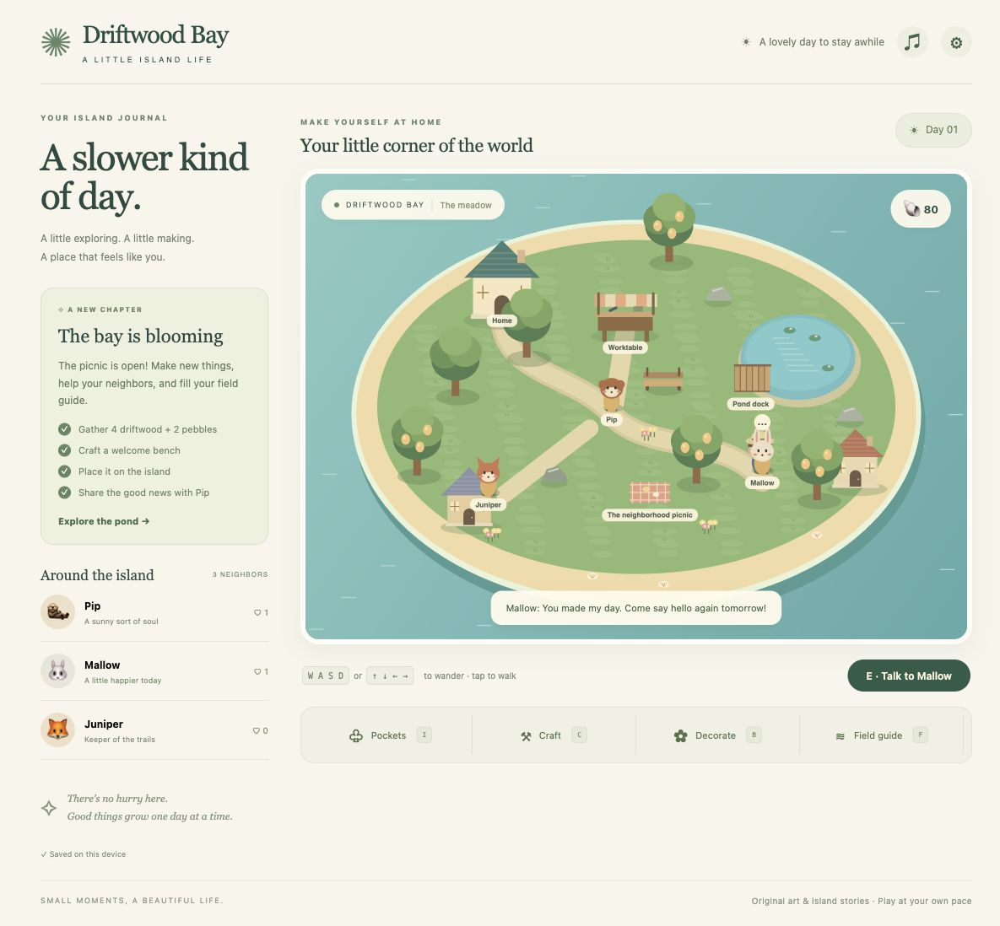

# Driftwood Bay

A small island. A slower kind of day. An original cozy island-life game inspired by the warmth, gathering, crafting, friendship and decorating of Animal Crossing: New Horizons. All island art, characters, dialogue, names and synthesized chimes are original; this project is unaffiliated with Nintendo.



## Play locally

Requires Node.js 22.12+ (Node 24 also works).

```bash
npm ci
npm run dev
```

Open the URL printed in your terminal, normally **http://127.0.0.1:5173**. Keep using the same browser and address to retain your island. For a production build, run `npm run build` and `npm run preview`.

## Your first five minutes

1. Say hello to Pip, the otter in the meadow.
2. Follow the journal's directions to gather two trees (4 driftwood) and a rock (2 pebbles).
3. Visit the worktable and craft the welcome bench.
4. Open Decorate, choose the bench, and tap open ground nearby. You can also walk to a clear spot and press P to place it ahead.
5. Tell Pip. The picnic appears and you earn 40 shells.

Then try the pond dock: cast a line, wait for **BITE**, and reel in. Mallow will trade shells and friendship for a fish. Juniper needs meadow fiber, Pip needs sunpears, and there are six furniture recipes and six fish species to discover. Rest at home whenever you want a new island day; resources and neighbor requests replenish, while progress stays.

## Controls

| Action | Keyboard / pointer |
| --- | --- |
| Walk | WASD or arrows; tap/click the island; journal destination buttons |
| Interact / cast / reel | E, Space, or the green action button |
| Pockets / Craft / Decorate / Field guide / Journal | I / C / B / F / J |
| Place a chosen decoration | Tap nearby open ground or P to place ahead |
| Cancel placement / close a menu | Escape |
| Phone movement | Hold the on-screen directional pad, or tap a destination |
| Sound | Music-note button; starts muted |

On desktop the journal stays beside the island. On phones it is in the bottom toolbar. Destination buttons plan a walk around the pond; arrow keys interrupt that walk. The action button always describes the nearest interaction. Furniture is reclaimed losslessly from Decorate when you stand nearby.

## Progress and privacy

Version 1 saves validate every inventory item, coordinate, collection, request and decoration. They auto-save in localStorage after actions, during walking, and when leaving. Settings includes JSON export/import and an explicit fresh-island control. An unreadable or future save is preserved and automatic overwrites are blocked; export its original data before starting fresh. Storage failures show a backup warning. Browser storage is not cloud storage: export before clearing it or changing devices/ports. There are no accounts, analytics, backend, network calls in the production game, or paid services.

## Development

```bash
npm run typecheck
npm test
npm run build
npm run check
```

Game rules: `src/game.ts`. Validated persistence: `src/save.ts`. Art: `src/world.ts`. Accessible menus, movement, routing, and effects: `src/main.ts`. Styling: `src/style.css`.

[Specification](docs/SPEC.md) · [Vocabulary](GLOSSARY.md) · [Architecture](docs/adr/0001-local-first-island.md) · [Skills and adaptations](docs/SKILLS.md) · [Verification](docs/VERIFICATION.md)

This is a polished small island game, with session-paced days, compact repeatable favors, six recipes and six fish. It does not attempt a sprawling commercial life simulator. Canvas has accessible DOM menus and keyboard navigation; a complete nonvisual spatial-game equivalent is not provided. Phone checks used viewport emulation in the user's Mac Chrome, not a physical phone.

## Rod and shadow fishing slice (local)
Equip the rod with **R** or **Equip rod**. Walk to the pond dock (Field guide → Walk to the pond dock); click water to face a shadow, then **E** casts a fixed distance ahead. The bobber must land in front of the fish’s head. False nibbles are not a catch cue: wait until the bobber visibly disappears and **UNDER!** appears, then press E within 0.85 seconds. Early/late reels fail. Movement, menus, Escape, blur and reload cancel the cast. Put the rod away with R to gather/talk normally.

This replaces the dock’s fixed catch timer. Two original silhouettes and seeded nibble counts make positioning and reaction meaningful. Catch/collection/selling use the existing island inventory. All existing v1 saves and keys are retained; rod, facing and cast state are transient, so no old island reset or offline catch occurs. The flat island camera and session-paced days remain. [Research, seams and QA route](docs/fidelity-fishing.md).

## Play online

[Play the hosted game](https://intrepion.github.io/kata-inspired-by-animal-crossing-new-horizons-codex-dot/)
